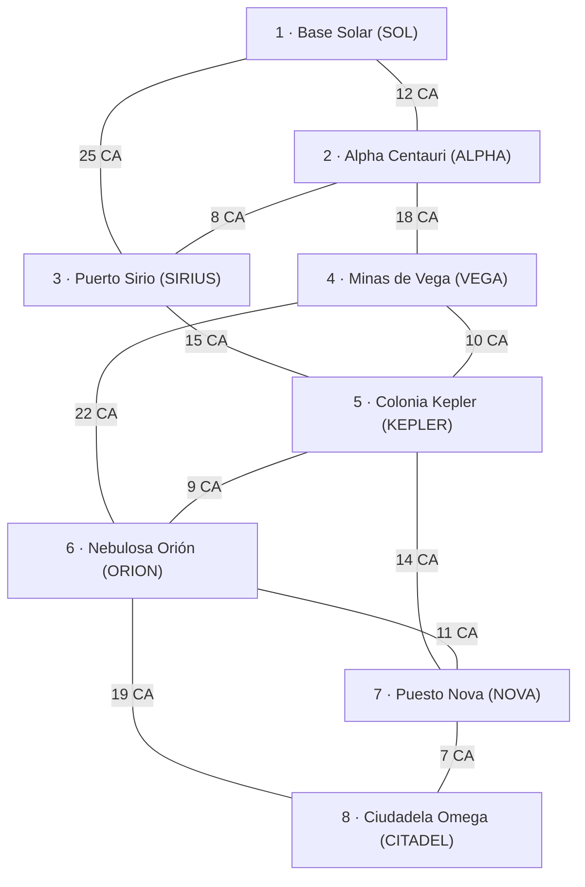

# Odisea Galáctica — TPO Programación III (UADE)

Computadora de navegación y logística de una nave carguera interplanetaria.
API REST en **Java 21 + Spring Boot 3 + Neo4j AuraDB** donde todos los algoritmos
(ordenamiento, greedy, grafos, programación dinámica, backtracking y branch & bound)
están implementados a mano, sin `Collections.sort()` ni librerías de grafos.

**Integrantes:**

- **Herrera, Alvaro Manuel** (LU: 1164449) — [@manuherrera09](https://github.com/manuherrera09)
- **Mendoza, Martina** (LU: 1185381) — [@martimpmy](https://github.com/martimpmy)
- **Traversi, María Paz** (LU: 1210230) — [@Maipi0512](https://github.com/Maipi0512)

## Dominio galáctico

El sistema representa la computadora de navegación y logística de una nave carguera
que opera dentro del sector estelar "Vía Láctea Austral".

La nave se desplaza entre distintas estaciones espaciales conectadas mediante rutas
hiperespaciales. Cada estación representa un punto de escala, comercio o
reabastecimiento, mientras que las rutas representan los posibles desplazamientos
entre estaciones.

Cada ruta posee un costo energético expresado en Celdas de Antimateria (CA), que
representa el consumo necesario para realizar el salto hiperespacial.

Además, la nave puede transportar cargamentos de minerales, que se registran en la
base de datos. Cada mineral posee:

- un nombre;
- un peso, expresado en toneladas;
- un valor comercial, expresado en Créditos Galácticos.

La nave cuenta con una capacidad máxima de carga, por lo que no siempre es posible
transportar todos los minerales disponibles.

### El grafo

| Elemento | En el dominio | En Neo4j |
|---|---|---|
| Vértice | Estación espacial (8) | `(:Estacion {id, nombre, sector})` |
| Arista | Ruta hiperespacial bidireccional (12) | `-[:RUTA_HIPERESPACIAL {costoCA}]->` en ambos sentidos |
| Peso | Consumo del salto en Celdas de Antimateria (CA > 0) | propiedad `costoCA` |
| Ítem | Lote de mineral (peso en t, valor en CG) | `(:Mineral {id, nombre, peso, valor})` |

Estaciones: Base Solar (`SOL`), Alpha Centauri (`ALPHA`), Puerto Sirio (`SIRIUS`),
Minas de Vega (`VEGA`), Colonia Kepler (`KEPLER`), Nebulosa Orión (`ORION`),
Puesto Nova (`NOVA`) y Ciudadela Omega (`CITADEL`).

Rutas (CA): SOL–ALPHA 12 · SOL–SIRIUS 25 · ALPHA–SIRIUS 8 · ALPHA–VEGA 18 ·
SIRIUS–KEPLER 15 · VEGA–KEPLER 10 · VEGA–ORION 22 · KEPLER–ORION 9 ·
KEPLER–NOVA 14 · ORION–NOVA 11 · ORION–CITADEL 19 · NOVA–CITADEL 7.

El grafo se carga automáticamente al iniciar si la base está vacía
([`db/seed-dominio.cypher`](src/main/resources/db/seed-dominio.cypher)).



### Las tres preguntas de validación del dominio

1. **¿Qué es una arista y qué número tiene encima?** "El salto entre la estación *u* y
   la estación *v* consume *N* Celdas de Antimateria". Peso positivo y simétrico:
   habilita Dijkstra, Prim y Kruskal.
2. **¿Tiene sentido el camino más barato de A a B por nodos intermedios?** Sí: por
   ejemplo SOL→SIRIUS directo cuesta 25 CA, pero SOL→ALPHA→SIRIUS cuesta 20 CA.
3. **¿Hay algo que seleccionar bajo una restricción de capacidad?** Sí: la bodega
   soporta *W* toneladas y hay que elegir qué minerales cargar para maximizar el valor
   (Greedy vs. Mochila 0/1).

### Aplicación del algoritmo Greedy

Para realizar una carga rápida de la bodega se utiliza una estrategia Greedy.

El criterio de selección consiste en priorizar los minerales que posean la mayor
relación entre valor comercial y peso:

ratio = valor / peso

En cada iteración se selecciona el mineral con mayor ratio que todavía pueda ser
incorporado sin superar la capacidad máxima de la bodega.

La estrategia continúa hasta evaluar todos los minerales disponibles o hasta que
ningún mineral restante pueda ser cargado.

El algoritmo Greedy busca obtener una buena solución de manera rápida, aunque no
garantiza encontrar siempre la solución óptima global para el problema de Mochila
0/1.

**Contraejemplo:** con capacidad 10 t y los minerales Cristal de Taquiones (6 t, 66 CG),
Núcleo de Plasma (5 t, 50 CG) y Aleación de Titanio (5 t, 50 CG), Greedy elige primero el
Cristal (ratio 11) y ya no entra nada más: **66 CG**. La solución óptima carga Núcleo +
Titanio: **100 CG**.

Esa solución óptima la calcula la Mochila 0/1 con Programación Dinámica
(`POST /api/bodega/cargar-optimo`), que completa la matriz `dp[i][c]` y recupera los
minerales elegidos recorriéndola hacia atrás. El paso a paso está en
[docs/CONTRAEJEMPLO.md](docs/CONTRAEJEMPLO.md).

## Cómo ejecutarlo

Requisitos: **JDK 21** (en Ubuntu: `sudo apt install openjdk-21-jdk-headless`) y una
instancia de Neo4j AuraDB.

1. Copiar `.env.example` a `.env` y completar con los datos de la consola de AuraDB.
   `.env` está en `.gitignore`: **nunca se commitea**.
   ```
   NEO4J_URI=neo4j+s://xxxxxxxx.databases.neo4j.io
   NEO4J_USERNAME=neo4j
   NEO4J_PASSWORD=...
   ```
2. Levantar la aplicación:
   ```bash
   ./mvnw spring-boot:run
   ```
3. Abrir la consola web en http://localhost:8080, el modo juego por niveles en http://localhost:8080/juego.html, o probar la API:
   ```bash
   curl localhost:8080/api/grafo/resumen
   ```

Tests (no necesitan la base de datos):

```bash
./mvnw test
```

El mismo comando genera el informe de cobertura en `target/site/jacoco/index.html`.

## Documentación

- [Catálogo de endpoints, con complejidades](docs/ENDPOINTS.md)
- [Contraejemplo Greedy vs. Mochila 0/1, con la matriz DP paso a paso](docs/CONTRAEJEMPLO.md)
- [Informe de complejidades asintóticas](docs/COMPLEJIDADES.md)
- [Auditoría de tests y cobertura](docs/AUDITORIA-TESTS.md)
- [Checklist de entrega](docs/CHECKLIST-ENTREGA.md)

## Uso de IA

En conformidad con las pautas de honestidad académica de la materia, se declara que para la realización de este proyecto se contó con el apoyo de las siguientes herramientas de inteligencia artificial generativa: **Google Gemini**, **Antigravity** y **Claude Code**.

Tareas en las que se utilizó asistencia de IA:

- **Modelado y consistencia del dominio:** Estructuración conceptual de la temática espacial ("Odisea Galáctica"), verificando que cumpliera con los requisitos de grafo ponderado, conexo y no bipartito con 8 vértices y 12 aristas.
- **Diseño de pruebas numéricas y casos borde:** Validación matemática previa de las matrices de distancias mínimas (Dijkstra y Floyd-Warshall), del árbol generador mínimo (Prim y Kruskal), del contraejemplo de Mochila 0/1 frente a Greedy y asistencia en la batería de tests unitarios.
- **Análisis teórico y documentación:** Verificación de parámetros de recurrencias ($a, b, k$) para la resolución mediante el Teorema Maestro, redacción y formateo de la documentación técnica en Markdown, y asistencia en el maquetado de la interfaz web estática (`index.html` y `juego.html`).
